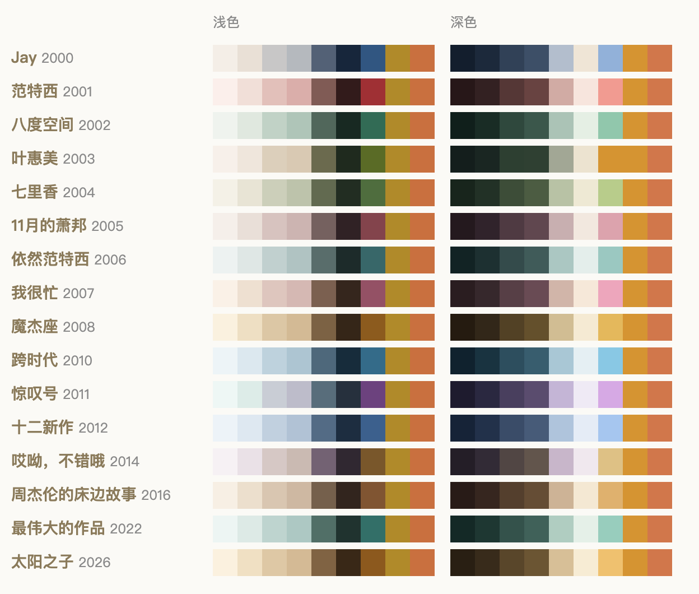

# 专辑皮肤 Album Skins · VS Code

把专辑封面变成 VS Code 主题。内置 16 张周杰伦专辑，每张深浅各一套；也能搜任意歌手的任意专辑，从封面自动取色生成主题。每天自动换一张，右下角显示今天的专辑名；还可以在窗口右侧显示一张往左渐隐的专辑封面。



内置专辑：Jay · 范特西 · 八度空间 · 叶惠美 · 七里香 · 11月的萧邦 · 依然范特西 · 我很忙 · 魔杰座 · 跨时代 · 惊叹号 · 十二新作 · 哎呦，不错哦 · 周杰伦的床边故事 · 最伟大的作品 · 太阳之子

## 功能

- **32 个内置主题**：配色是看着每张专辑的封面手调的，界面、代码高亮、终端 16 色、括号彩虹色都覆盖到，也给 [Error Lens](https://marketplace.visualstudio.com/items?itemName=usernamehw.errorlens) 配了色。代码文字与背景的对比度不低于 4.5:1（WCAG AA），注释不低于 3.2:1。
- **添加任意专辑**：搜专辑名或歌手（走 Apple iTunes 公开接口），选中后用封面自动取色，生成深浅两套配色，先预览再决定保不保留。最多 10 张。
- **每日换专辑**：三种方式——全部洗牌（一轮内不重复）、只从收藏里洗牌、按发行年份依次轮换。不喜欢的专辑可以排除。
- **选专辑时预览**：在列表里上下移动，配色就跟着变；按 Esc 还原。
- **状态栏角标**：右下角用这张专辑的金色显示「♪ 专辑名」。点一下打开专辑列表。
- **低调模式**：一键隐藏角标和封面，只留配色，适合开会投屏。
- **跟随系统外观**：同一张专辑，白天浅色、晚上深色。
- **渐隐封面（可选）**：窗口右侧显示当前专辑的封面，往左慢慢淡掉。换专辑时封面跟着换，不用重载窗口。

## 安装

1. 到 [Releases](https://github.com/jakob52123/album-skins-vscode/releases) 下载最新的 `.vsix` 文件。
2. 在 VS Code 的扩展面板点右上角「…」，选「从 VSIX 安装…」（Install from VSIX…）；或者在终端运行：

   ```sh
   code --install-extension album-skins-2.0.1.vsix
   ```

装好后会自动切到今天的专辑。

## 用法

点状态栏右下角的专辑名，或在命令面板（`Cmd/Ctrl+Shift+P`）搜「专辑皮肤」。

| 想做什么 | 怎么做 |
|---|---|
| 换专辑 | 「专辑皮肤：选专辑」，上下移动预览，回车确定 |
| 收藏 / 排除某张 | 在专辑列表里点这一行右边的 ☆ / ⊘ |
| 加一张别的专辑 | 「专辑皮肤：添加专辑…」，或在专辑列表里选「添加专辑…」 |
| 删掉自己加的专辑 | 专辑列表里点这一行右边的 🗑 |
| 随机换一张 | 「专辑皮肤：换一张」 |
| 取消手动选择，回到每天自动换 | 「专辑皮肤：恢复每日随机」 |
| 开会时隐藏角标和封面 | 「专辑皮肤：低调模式（开/关）」 |
| 改每日换的方式 | 设置 `albumSkins.shuffle`：`all` / `favorites` / `release-order` |
| 白天浅色、晚上深色 | 设置里打开 `albumSkins.followSystemAppearance` |

换成别的主题后，扩展就不会再自动换，角标也会隐藏。

### 自己加的专辑是怎么存的

- 取色结果和封面存在 VS Code 给扩展的全局存储目录里，不会写进你的项目。
- VS Code 的主题必须在安装时就声明好，所以扩展预留了 10 个「专辑皮肤 · 自定义 NN」空位主题。你加的专辑会占用一个空位，它的颜色通过 VS Code 官方的 `workbench.colorCustomizations`（以及代码高亮的两个同类设置）按主题名写进用户设置。扩展只写当前正在用的那一张，切走时会换成下一张的颜色。
- 自动取色不如手调：有的封面颜色很少（比如黑白照片），生成的配色会偏素。

## 渐隐封面

这个功能依赖另一个扩展 [background](https://marketplace.visualstudio.com/items?itemName=shalldie.background)（shalldie.background），默认是关着的。

1. 安装 background 扩展。
2. 在设置里打开 `albumSkins.syncBackground`。
3. 第一次打开时，扩展会从 Apple iTunes 下载 16 张内置封面到本机，大约 3 MB。
4. background 扩展会提示重载窗口，点确认。只需要这一次，之后换专辑、加专辑，封面都会直接跟着换。

需要知道的几件事：

- 这会接管 background 扩展的「全屏」（fullscreen）背景设置。原来的设置会先保存起来，关掉 `albumSkins.syncBackground` 后自动还原。
- background 扩展靠修改 VS Code 自己的文件来显示背景图，这是它本身的工作方式，它的文档里有说明。因此 VS Code 可能提示「安装似乎已损坏」（实测 1.143 会出现），可以忽略。
- 换封面不用重载，靠的是借 background 扩展的自定义样式写入一组「主题 → 封面」的 CSS 规则；低调模式即时隐藏封面，靠的是规则里判断状态栏角标在不在。这些都不是 background 扩展官方支持的用法，它以后升级如果改了样式处理方式，封面可能不显示，但配色不受影响。

## 自己构建

主题文件、`albums.json` 和 `package.json` 都是 `build.js` 从 `data/albums.json` 生成的。配色映射在 `lib/theme.js`，内置专辑和自加专辑共用；自动取色在 `lib/palette.js`。要改内置配色，就改 `data/albums.json`，然后：

```sh
node build.js                        # 重新生成 themes/、albums.json、package.json、docs/palettes.svg
node --test lib/                     # 对比度、取色、构建产物检查
npx @vscode/vsce package             # 打包成 .vsix
```

## 版权说明

- 本项目是粉丝自制作品，与周杰伦本人、杰威尔音乐、各唱片公司以及其他任何歌手都没有关系，也没有得到他们的认可。专辑名称只用于标明配色的灵感来源。
- 本仓库**不包含**任何专辑封面。封面只在你需要时（显示封面、专辑列表的小图、添加专辑时取色）从 Apple iTunes 下载到你自己的电脑上，版权归原权利人所有。
- 代码和配色数据以 [MIT 许可证](LICENSE) 开源。

---

**English:** Turn album covers into VS Code color themes. Ships 32 hand-tuned themes from 16 Jay Chou albums (light + dark), and lets you add any album from Apple iTunes — its palette is generated automatically from the cover. Daily rotation (shuffle / favorites only / release order), live preview while picking, a status-bar album label, a discreet mode for screen sharing, follow-system light/dark, and an optional fading album-cover background (requires the `shalldie.background` extension). Covers are downloaded at runtime and are not distributed with this repository. Fan-made, not affiliated with or endorsed by any artist or label. MIT licensed.
